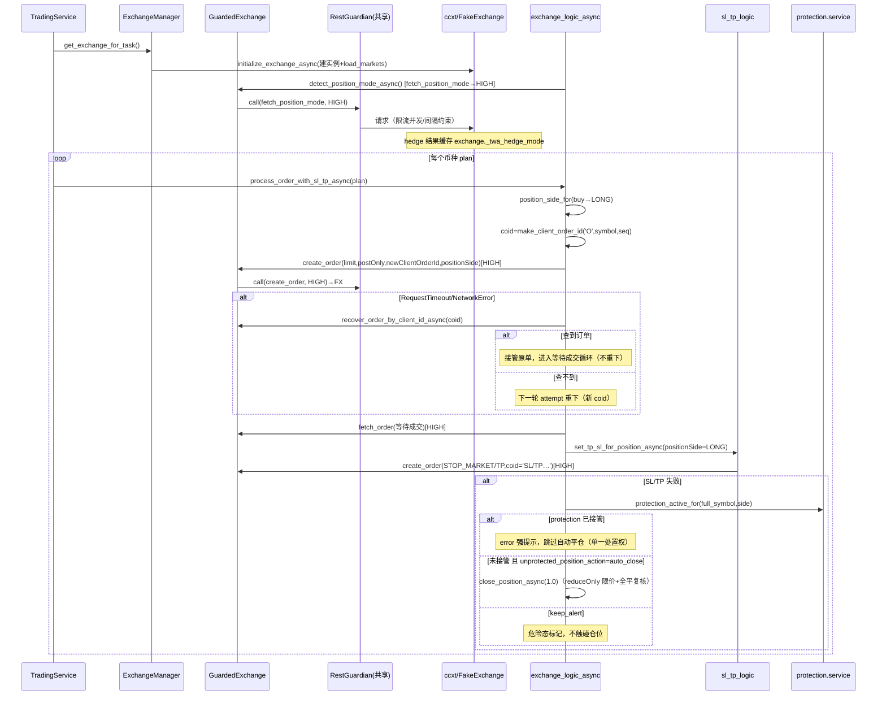
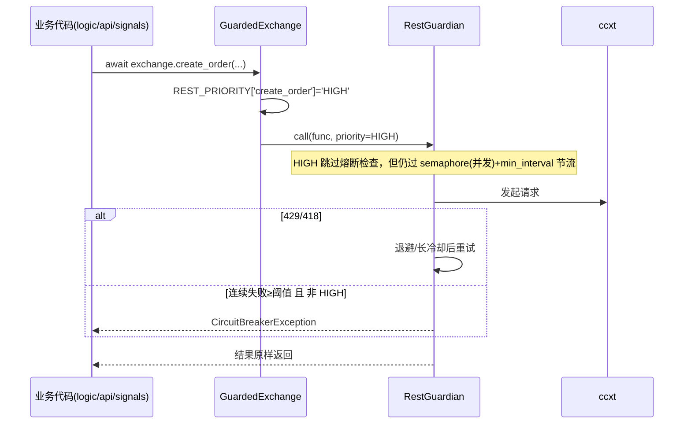
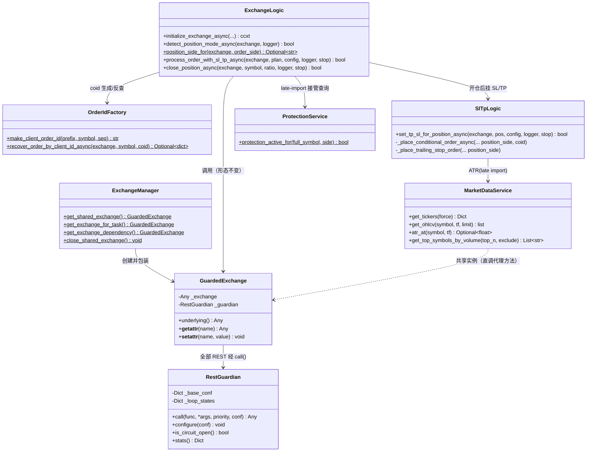

# 架构设计 — Phase 3 增量重构（复用 / 性能 / 安全 / 限流合规 / 整合 / 完整性）

> 作者：架构师 Bob（software-architect）
> 需求来源：`docs/PRD_REFACTOR_PHASE3.md`（唯一需求来源）
> 历史契约：`REFACTORING_REPORT.md`（Phase 1）、`MERGE_PLAN.md`（Phase 2）、`CODE_REVIEW.md`
> 日期：2026-11-13
> 硬约束：不改交易行为语义（限价 post-only 开仓、USDC 优先、做多绿/做空红）；≥10 行重复代码禁止；全部 REST 经 RestGuardian；测试全离线；默认不实际下单。

---

## 1. 实现方案与关键设计决策

### 1.1 核心技术挑战与选型

| 挑战 | 方案 | 理由 |
|---|---|---|
| 交易链路 ccxt 调用无感接入 RestGuardian | `GuardedExchange` 动态代理层（`__getattr__` 拦截 REST 方法名） | 业务代码调用形态完全不变（`await exchange.create_order(...)`），无需修改 12.4k 行里的每个调用点；优先级按方法名静态映射，零运行时开销 |
| 下单幂等 | 确定性 `newClientOrderId` + 超时后按 clientOrderId 反查接管 | Binance 原生支持 `origClientOrderId` 查询；fake exchange 扩展即可离线测试 |
| 裸仓回收与 protection v2 协调 | `process_order_with_sl_tp_async` 内 late-import 查询 protection 接管状态，接管则跳过自动平仓 | 避免 logic→protection 的 import 环（沿用 `sl_tp_logic._resolve_atr` 的 late-import 先例）；单一处置权归 protection，主链路只做兜底 |
| positionSide 检测落点 | `initialize_exchange_async` 成功后探测一次，结果缓存到 exchange 对象属性 `_twa_hedge_mode`，下单点按需读取 | 任务级 exchange 实例生命周期与探测结果天然对齐；单实例只探测一次，零重复请求 |
| 前端拆分 | 沿用既有先例（`components/signals/*` + PageCard），新增 `composables/useXxxConfig.ts` 模式 | 与 `components/signals/*` 面板拆分同一套模式，团队已验证 |
| 策略线程派发 | (symbol, timeframe) 粒度合并：一次 `to_thread` 顺序跑该组合全部策略 | 策略函数签名不变、判定逻辑不动，只改派发层 |

架构模式不变：FastAPI 单体 + 分层（api / core / logic / signals / protection）+ Vue3 组合式前端。**不引入新框架**。

### 1.2 R-P1-1：GuardedExchange 代理层设计（关键决策）

**设计要点**（新增 `core/guarded_exchange.py`）：

1. **优先级静态映射表**：`REST_PRIORITY: dict[str, str]` 声明每个 ccxt REST 方法名的优先级。业务代码不感知优先级，代理按方法名自动打标：
   - **HIGH（绕过熔断，仍受并发/最小间隔约束）**：`create_order`、`cancel_order`、`cancel_all_orders`、`edit_order`、`fetch_order`、`fetch_open_orders`、`fetch_positions`、`fetch_position_mode`、`fetch_balance`、`set_leverage`——交易决策与下单撤单类，熔断期间不能阻断止损/平仓（Q6 默认值）。
   - **NORMAL**：`fetch_tickers`、`fetch_ticker`、`fetch_order_book`、`load_markets`、`fetch_funding_rate` 等行情/元数据读。
   - **LOW**：`fetch_ohlcv`（大批量扫描读，最易触发限流）。
   - 不在表内的一切属性/方法（`markets`、`amount_to_precision`、`price_to_precision`、`close`、`set_sandbox_mode` 等）**原样透传**，不包装。

2. **包装点唯一**：`exchange_manager.get_exchange_with_timeout()` 拿到原始 ccxt 实例后立即包一层 `GuardedExchange(exchange, shared_guardian())`；`get_shared_exchange()` / `get_exchange_for_task()` / `get_exchange_dependency()` 返回的都是包装实例。**全项目只有一个地方接触裸 ccxt**（`initialize_exchange_async` 构造 + 代理层本身）。

3. **`__setattr__` 同步委托**：R-P0-3 会往 exchange 对象写 `_twa_hedge_mode` 缓存；代理必须把属性写转发到 underlying，否则缓存会落在代理上、随实例丢弃。

4. **共享单一 RestGuardian**：新增 `rest_guardian.shared_guardian()` 进程级单例；`MarketDataService` 放弃自建 guardian（删掉 `guardian=` 参数的私有实例），代理层与行情层共用同一个并发/节流/熔断状态——这是"统一背压"成立的前提。参数热更新只需 `shared_guardian().configure(settings)` 一处。

5. **fake 测试路径零影响**：logic 层测试直接传 `FakeExchange`，不经过 `exchange_manager`，代理完全不参与；代理自身行为由新 `test_guarded_exchange.py` 用 FakeExchange + 计数 guardian 覆盖。

6. **静态审计规则（R-P1-1 验收①的可执行口径）**：`test_no_direct_rest.py` 用 AST 断言：
   - `ccxt.binanceusdm(` / `ccxt.async_support` 的引用只出现在白名单（`logic/exchange_logic_async.py`、`core/guarded_exchange.py`）；
   - `.underlying` 属性访问只出现在 `core/guarded_exchange.py`；
   - `RestGuardian(` 实例化只出现在 `core/rest_guardian.py`；
   - 运行时用例：`get_shared_exchange()` 返回 GuardedExchange，其 `create_order` 调用被共享 guardian 计数（HIGH 优先级生效断言）。

### 1.3 R-P0-1：下单幂等（clientOrderId 生成与超时反查）

- **生成**（新增 `logic/order_id.py`）：`make_client_order_id(prefix, symbol, seq)` → `f"{prefix}{ts_base36}{coin}{seq}"`，如 `O{M1A2B3C4}BTC1`；prefix ∈ {O=开仓, C=平仓, SL, TP, TS=移动止盈}；字符集全部落在 Binance `^[\.A-Za-z0-9_-]{1,36}$` 合规集内，长度 ≤36。唯一性 = 毫秒时间戳(base36) + 模块级 `itertools.count` 单调 seq，单进程内绝对唯一。
- **主链路**（`_execute_maker_order_with_retry_async`）：每轮 attempt 生成新 coid 放入 `params['newClientOrderId']`；`create_order` 抛 `ccxt.RequestTimeout / NetworkError / ExchangeNotAvailable` 时进入反查分支：
  1. `recover_order_by_client_id_async(exchange, symbol, coid)`：先扫 `fetch_open_orders(symbol)` 按 ccxt 统一 `clientOrderId` 字段匹配；未命中再 `fetch_order(coid, symbol, params={'origClientOrderId': coid})`，`OrderNotFound` → 返回 None；
  2. 查到 → **接管**该单（order_id = 反查结果 id），直接进入既有的成交等待循环，不重下；
  3. 查不到 → 才允许下一轮 attempt 重下（新 coid）。
- **平仓路径同一实现**：close 走同一个执行器，prefix 用 `C`，无需单独逻辑。
- **SL/TP 条件单**（`sl_tp_logic_async._place_conditional_order_async` / `_place_trailing_stop_order`）：带 `SL/TP/TS` prefix 的 coid；遇网络类错误先按 coid 扫 `fetch_open_orders`，查到即视为成功（返回该单），查不到才走现有重试。
- **原有的"撤单失败即中止"保护不变**；本设计只处理"请求根本没到達/超时"的窗口。

### 1.4 R-P0-2：裸仓回收与 protection v2 协调（避免双重处置）

落点在 `process_order_with_sl_tp_async` 的 `sltp_ok == False` 分支，顺序：

1. **查询 protection 接管状态**（late import `protection.service.protection_active_for(full_symbol, side)`）：protection v2 已启用且正在管理该仓位（`position_protection.enabled=True` 且引擎 state 中存在该 (symbol, side) key）→ **跳过自动平仓**，只记 error 强提示（处置权归 protection 的应急减仓/灾难止损，单一处置权避免两边同时发单互相顶单）。
2. **未接管**：按 `unprotected_position_action`（默认 `auto_close`）：
   - `auto_close`：立即 `close_position_async(exchange, full_symbol, 1.0, ...)`（复用既有全平：reduceOnly 限价 post-only + 全平复核，语义零新增）。成功 → 记 warning「仓位已自动回收」；失败 → error「自动平仓也失败，仓位无保护，请立即人工处理」。
   - `keep_alert`：不触碰仓位，任务标记危险态（error 级日志 + 结果项带 `danger: 'unprotected'`）。
3. **任务结果如实反映**：SL/TP 失败无论回收与否，`process_order_with_sl_tp_async` 返回 `False`（任务计为失败，失败计数如实），结果项附加 `auto_closed: bool` 供台账/前端区分"开仓成功"与"开仓后回收"。
- protection 侧新增只读查询 `protection_active_for()`（`protection/service.py`），不改 protection 判定逻辑。

### 1.5 R-P0-3：positionSide 检测落点

- **探测**：`initialize_exchange_async` 里 `load_markets()` 成功后调 `fetch_position_mode_async`（ccxt binanceusdm 原生方法，返回 `{hedged: bool}`）；探测失败 → `logger.warning` + 按单向继续（不静默吞、不阻塞启动）。结果写 `exchange._twa_hedge_mode`（经代理 `__setattr__` 落到 underlying，实例生命周期内只探测一次）。
- **注入点**（3 处，全部跟随订单/仓位方向）：
  - 开仓：`_execute_maker_order_with_retry_async` 新增 `position_side` 参数 → 合入 create_order params（buy→LONG，sell→SHORT）；
  - 平仓：`close_position_async` 已知 `pos_amt` 符号 → 传持仓方向（LONG 仓平仓单 positionSide=LONG）；
  - SL/TP 条件单与移动止盈：`set_tp_sl_for_position_async` 按 `is_long` 传给 `_place_conditional_order_async` / `_place_trailing_stop_order`（新增同名参数）。
  - **单向模式不携带该字段**（传 'BOTH' 会有 -4061 风险，宁缺勿错）。
- 辅助函数 `position_side_for(exchange, order_side)` 集中判断，避免 3 处重复。

### 1.6 R-P0-4：最小名义价值校验

`_min_notional(exchange, symbol)`：读 `market['limits']['cost']['min']`，缺省 5.0 USDT。校验放 `_execute_maker_order_with_retry_async` 内、create_order 之前（`remaining * price < min_notional` 时）：已有部分成交 → 记 warning 后返回 True（同现有 min_amount 语义）；零成交 → 记 **skip** 日志返回 False，任务其余币种继续。FakeExchange markets 增加 `limits.cost.min` 字段供离线测试。

### 1.7 R-P0-5：WS 鉴权

- `core/security.py` 新增 `verify_ws_token(token) -> bool`（复用 `_keys_equal` + `get_app_access_key()`）与 `ws_auth_disabled() -> bool`（**仅**读环境变量 `WS_AUTH_DISABLED=1`，配置文件不支持该项，Q4 默认决策）。
- `main.py /ws`：握手阶段取 `websocket.query_params['token']`；失败 → `logger.warning`（不含 token 内容）→ `accept()` 后立即 `close(code=4401)`；禁用开关开启时打 error 级醒目告警后放行。
- `services/websocket.ts`：`getWebSocketUrl()` 追加 `?token=`（取自 `authStore.accessKey`，未认证时不带）。
- 前端冒烟：`vue-tsc` + 手动验证 4401 → 现有指数退避重连路径不崩溃。

### 1.8 前端拆分与写入口收敛（R-P2-2/3/4）

- **composables 模式**：`useSignalsConfig.ts` / `useProtectionConfig.ts` 统一 patch 写（仿 `settingsStore.patchSettings` 的 `{ok, detail}` 语义），消灭 SignalsView 8 处单字段 post 与 ProtectionView 整包直写——每个配置域一条写路径。
- **ControlPanel 草稿模式**：`composables/useDraftSettings.ts`（`draft = cloneDeep(settings)` + `hydrated` 闸门 + diff 提交），3 个 watcher 收敛为 draft 单向绑定；CoinPoolsManager 5 个 watcher 合并为 computed 驱动。
- **endpoints.ts**：`services/endpoints.ts` 常量 + 强类型 API 函数；eslint `no-restricted-syntax` 禁 `'/api/` 字面量与 `toFixed`/`toLocaleString`（format.ts / tone.ts 除外）；format.ts 扩展缺失的金额/百分比/方向标签函数。
- **组件归属**：SignalsView → 状态卡/表格子组件；ProtectionView → `components/protection/{StatusCard,RiskSettingsPanel,ConfigForm}.vue`；全部复用 PageCard/SectionHeader/SmartSelect/MetricCard/EmptyState，色调只引用 `utils/tone.ts`。

### 1.9 protection/engine.py 拆分（R-P2-1）

按职责拆 6 个模块 + engine.py 变 facade（re-export 保持 `from .engine import x` 的既有测试导入不变）：

```
protection/
  config.py        # DEFAULT_CONFIG + load_protection_config（DB 优先，复用 signals/config_store.deep_merge，删 _load_config/_deep_merge_defaults）
  state.py         # _load_state/_save_state/_state_key + Runtime + action lock
  market_data.py   # K 线/ATR/EMA 行情快照（_closed_df/_atr_from_df/_ema_*…，纯计算留 risk_model）
  stops.py         # 止损判定（动态保护/灾难止损/_strategy_levels_from_rows…）
  take_profit.py   # TP 阶梯初始化/命中/保护性止损
  exits.py         # 应急减仓/市价单（静态审计白名单落点）+ stop/TP 管理
  engine.py        # facade：轮询主循环 + re-export（测试零改动）
```

判定/动作语义零改动，`test_protection_v2` 全绿为闸门。

---

## 2. 文件清单（新增 A / 修改 M / 删除 D，标注改动要点）

### 后端

| 文件 | 类型 | 改动要点 |
|---|---|---|
| `backend/app/logic/order_id.py` | A | clientOrderId 生成 + 超时反查 `recover_order_by_client_id_async` |
| `backend/app/logic/exchange_logic_async.py` | M | ①create_order 带 coid+反查接管；②minNotional 校验；③hedge 探测+positionSide 注入（开/平）；④裸仓回收分支；⑤平仓让价 chase；⑥**删除** `fetch_klines_async`；⑦`InterruptedError`→`TaskInterruptedError` |
| `backend/app/logic/sl_tp_logic_async.py` | M | 条件单/移动止盈带 coid+反查；positionSide 参数；InterruptedError 替换 |
| `backend/app/logic/exceptions.py` | M | `InterruptedError` → `TaskInterruptedError`（全仓同步替换含测试） |
| `backend/app/core/guarded_exchange.py` | A | GuardedExchange 代理（REST_PRIORITY 映射、getattr/setattr 委托） |
| `backend/app/core/rest_guardian.py` | M | `shared_guardian()` 单例 + `configure()` 热更新已在（补 settings 联动） |
| `backend/app/core/exchange_manager.py` | M | 包装 GuardedExchange；print→loguru |
| `backend/app/core/security.py` | M | `verify_ws_token` / `ws_auth_disabled` |
| `backend/app/core/websocket_manager.py` | M | 无逻辑改动（鉴权在 main 层）；print/注释核对 |
| `backend/app/main.py` | M | /ws token 校验 + 4401；`init_app_storage()` 进 lifespan；print→loguru（启动横幅白名单） |
| `backend/app/config/config.py` | M | DEFAULT_CONFIG 增 `unprotected_position_action/close_price_chase_ticks/api_*`；init_db 移出 import 期；print→loguru |
| `backend/app/core/database.py` | M | `init_app_storage()` 供 lifespan 调用；print→loguru |
| `backend/app/core/trading_service.py` | M | 传递任务上下文（结果项 auto_closed/danger）；InterruptedError 导入替换 |
| `backend/app/api/settings.py` | M | api_* / 新配置范围校验（越界 400）；保存后 `shared_guardian().configure()` |
| `backend/app/api/rebalance.py` | M | K 线改走 `shared_market_data().get_ohlcv`；fetch_tickers 经代理 |
| `backend/app/api/positions.py` | M | 无逻辑改动（exchange 已是代理实例） |
| `backend/app/signals/scanner.py` | M | interval 每轮重读；(symbol,timeframe) 合并派发 |
| `backend/app/signals/market_data.py` | M | 删自建 guardian，直调代理方法；`get_ohlcv` 供 rebalance 复用 |
| `backend/app/protection/config.py` `state.py` `market_data.py` `stops.py` `take_profit.py` `exits.py` | A | engine.py 按职责拆分（语义零改动） |
| `backend/app/protection/engine.py` | M | 变 facade（re-export），删 `_load_config/_deep_merge_defaults` |
| `backend/app/protection/service.py` | M | 新增只读 `protection_active_for(full_symbol, side)` |
| `backend/app/open_history.py`、`signals/runtime.py` | M | print→loguru |
| `backend/tests/conftest.py` | M | FakeExchange 扩展：clientOrderId 索引/反查、注入网络异常钩子、`limits.cost.min`、`hedge_mode`/`fetch_position_mode`、`fetch_position_mode` |
| `backend/tests/test_order_idempotency.py` | A | 超时入簿→接管不重下；查不到→才重试；coid 格式/唯一性 |
| `backend/tests/test_bare_position_recovery.py` | A | auto_close 触发全平 / keep_alert 不触碰 / protection 接管跳过 |
| `backend/tests/test_hedge_mode.py` | A | hedge→全部单带 positionSide；单向→不带；探测失败→warning+单向 |
| `backend/tests/test_min_notional.py` | A | 3 USDT skip、其余币种继续 |
| `backend/tests/test_ws_auth.py` | A | 无 token 拒 4401；正确 token 收消息；开关降级 |
| `backend/tests/test_guarded_exchange.py` | A | 优先级映射/透传/HIGH 绕熔断仍限流/setattr 委托 |
| `backend/tests/test_no_direct_rest.py` | A | AST 审计三规则（1.2-6） |
| `backend/tests/test_static_audit.py` | M | 市价白名单=protection/exits.py（reduceOnly+平仓方向），负向用例 |
| `backend/tests/test_scanner.py`、`test_close_position.py`、`test_process_order.py`、`test_sl_tp.py`、`test_settings_persist.py` 等 | M | 随行为扩展补断言；InterruptedError 重命名联动 |

### 前端

| 文件 | 类型 | 改动要点 |
|---|---|---|
| `frontend/src/services/endpoints.ts` | A | 全部 API 路径常量 + 强类型函数（唯一路径来源） |
| `frontend/src/utils/format.ts` | M | 扩展金额/百分比/方向标签函数，承接 23 处 toFixed/toLocaleString |
| `frontend/src/composables/useSignalsConfig.ts` | A | signals 配置统一 patch 读写（替换 8 处散点 post） |
| `frontend/src/composables/useProtectionConfig.ts` | A | protection 配置统一 patch 写 |
| `frontend/src/composables/useDraftSettings.ts` | A | ControlPanel 草稿模式（cloneDeep+hydrated+diff 提交） |
| `frontend/src/components/protection/StatusCard.vue` `RiskSettingsPanel.vue` `ConfigForm.vue` | A | ProtectionView 拆分（均 ≤400 行，复用 PageCard/MetricCard） |
| `frontend/src/components/signals/*`（补充状态卡等） | M/A | SignalsView 继续下沉 |
| `frontend/src/views/SignalsView.vue` | M | 拆分后 ≤400 行，写入口走 useSignalsConfig |
| `frontend/src/views/ProtectionView.vue` | M | 拆分后 ≤400 行 |
| `frontend/src/components/ControlPanel.vue` | M | 草稿模式，watcher 3→0（draft 单向绑定） |
| `frontend/src/components/CoinPoolsManager.vue` | M | 5 watcher → computed 驱动 |
| `frontend/src/services/websocket.ts` | M | URL 带 `?token=`（authStore） |
| `frontend/src/views/SettingsView.vue` + `stores/settingsStore.ts` + `models/types.ts` | M | 新增 api_*、unprotected_position_action、close_price_chase_ticks 字段 |
| `frontend/src/main.ts` | M | 移除全量 components/directives import |
| `frontend/vite.config.ts` | M | vite-plugin-vuetify 按需 + manualChunks（vuetify/echarts） |
| `frontend/package.json` | M | devDependency: vite-plugin-vuetify |
| `frontend/eslint.config.ts` | M | type-checked 规则 + `no-restricted-syntax`（裸 '/api/'、toFixed/toLocaleString） |

---

## 3. 关键数据结构与接口签名

```python
# ── core/guarded_exchange.py（新增）─────────────────────────────
REST_PRIORITY: dict[str, str] = {
    # HIGH：交易关键，绕过熔断（仍受并发/最小间隔约束）
    'create_order': 'HIGH', 'cancel_order': 'HIGH', 'cancel_all_orders': 'HIGH',
    'edit_order': 'HIGH', 'fetch_order': 'HIGH', 'fetch_open_orders': 'HIGH',
    'fetch_positions': 'HIGH', 'fetch_position_mode': 'HIGH',
    'fetch_balance': 'HIGH', 'set_leverage': 'HIGH',
    # NORMAL：行情/元数据读
    'fetch_tickers': 'NORMAL', 'fetch_ticker': 'NORMAL',
    'fetch_order_book': 'NORMAL', 'load_markets': 'NORMAL',
    'fetch_funding_rate': 'NORMAL', 'fetch_leverage': 'NORMAL',
    # LOW：大批量扫描读
    'fetch_ohlcv': 'LOW',
}

class GuardedExchange:
    """ccxt 异步 exchange 的限流代理；非 REST 属性原样透传。"""
    def __init__(self, exchange: Any, guardian: RestGuardian) -> None: ...
    @property
    def underlying(self) -> Any: ...
    def __getattr__(self, name: str) -> Any:
        """name in REST_PRIORITY 且可调用 → 返回经 guardian.call(priority=...) 包装的协程函数；否则透传。"""
    def __setattr__(self, name: str, value: Any) -> None:
        """属性写委托到 underlying（_twa_hedge_mode 等缓存落在真实实例上）。"""

# ── core/rest_guardian.py（修改）───────────────────────────────
def shared_guardian() -> RestGuardian:
    """进程级单例；api/settings 保存后 configure() 热更新。"""

# ── logic/order_id.py（新增）───────────────────────────────────
def make_client_order_id(prefix: str, symbol: str, seq: int | None = None) -> str:
    """prefix∈{O,C,SL,TP,TS}；返回 f'{prefix}{base36(ts_ms)}{coin}{seq}'，≤36 字符，单进程唯一。"""

async def recover_order_by_client_id_async(exchange, symbol: str, client_order_id: str) -> dict | None:
    """1) fetch_open_orders 按 clientOrderId 匹配；2) fetch_order(origClientOrderId)；
    OrderNotFound/未命中 → None（调用方才允许重下）。"""

# ── logic/exchange_logic_async.py（修改）──────────────────────
async def detect_position_mode_async(exchange, async_logger) -> bool:
    """fetch_position_mode 探测；结果缓存 exchange._twa_hedge_mode；失败 warning+False。"""

def position_side_for(exchange, order_side: str) -> str | None:
    """hedge 模式下 order_side→LONG/SHORT；单向返回 None（不携带）。"""

def _min_notional(exchange, symbol: str) -> float:
    """market.limits.cost.min，缺省 5.0。"""

async def _execute_maker_order_with_retry_async(
    exchange, symbol, side, params, timeout, retries, async_logger, stop_event, *,
    value_to_trade=None, contracts_to_trade=None,
    position_side: str | None = None,          # 新增：hedge 注入
    price_chase_ticks: int = 0,                # 新增：平仓让价（0=关闭），仅 reduceOnly 路径使用
) -> bool: ...

async def process_order_with_sl_tp_async(exchange, plan, config, async_logger, stop_event) -> bool:
    """SL/TP 失败 → protection 接管判断 → unprotected_position_action(auto_close/keep_alert)。"""

# ── logic/sl_tp_logic_async.py（修改）─────────────────────────
async def _place_conditional_order_async(exchange, symbol, side, amount, trigger_price,
                                         order_type, async_logger,
                                         position_side: str | None = None,
                                         client_order_id: str | None = None) -> dict | None: ...
async def _place_trailing_stop_order(exchange, symbol, side, amount, callback_rate,
                                     async_logger, position_side: str | None = None) -> dict | None: ...

# ── protection/service.py（修改）──────────────────────────────
def protection_active_for(full_symbol: str, side: str) -> bool:
    """position_protection.enabled 且引擎 state 管理该 (symbol, side) → True（只读）。"""

# ── core/security.py（修改）───────────────────────────────────
def verify_ws_token(token: str) -> bool: ...
def ws_auth_disabled() -> bool:  # 仅环境变量 WS_AUTH_DISABLED=1

# ── config/config.py DEFAULT_CONFIG 新增 ──────────────────────
# 'unprotected_position_action': 'auto_close'   # ∈ {auto_close, keep_alert}
# 'close_price_chase_ticks': 1                  # 0..10，0=关闭
# 'api_max_concurrency': 3, 'api_min_interval_sec': 0.08, 'api_max_retries': 3,
# 'api_failure_threshold': 5, 'api_circuit_breaker_cooldown_sec': 30,
# 'api_418_cooldown_sec': 60, 'api_429_base_backoff_sec': 2, 'api_429_max_backoff_sec': 30
```

```typescript
// ── services/endpoints.ts（新增，节选）───────────────────────
export const ENDPOINTS = {
  settings: '/api/settings',
  settingsPatch: '/api/settings/patch',
  positions: '/api/positions',
  positionsClose: '/api/positions/close',
  signalsConfig: '/api/signals/config',
  signalsAutoTrade: '/api/signals/auto-trade',
  protectionConfig: '/api/protection/config',
  rebalancePlan: '/api/rebalance/plan',
  // ... 15 条路径唯一来源
} as const
export const api = {
  getSettings: () => http.get<Settings>(ENDPOINTS.settings),
  patchSignalsConfig: (patch: Partial<SignalsConfig>) => http.post(ENDPOINTS.signalsConfig, patch),
  // ...强类型函数；组件禁止出现裸 '/api/' 字符串
}
```

---

## 4. 核心调用流程

### 4.1 开仓全流程（幂等 + 裸仓回收 + hedge 注入）



### 4.2 REST 统一限流（GuardedExchange 语义）



---

## 5. 类图



---

## 6. 依赖包变更

```
后端：无新增第三方依赖（ccxt / fastapi / loguru 已有）
前端：
- vite-plugin-vuetify@^3.1.0 (devDependency)：Vuetify 按需引入（Q3：若本地不可安装，降级为 manualChunks 拆包，本项留待联网迭代）
其余无变更（不引入 vitest 等，见待明确事项）
```

---

## 7. 任务列表（按依赖与资金安全优先排序，14 条）

| ID | 任务 | 涉及文件 | 依赖 | 规模 | 验收要点 |
|---|---|---|---|---|---|
| **T01** | 下单幂等 + 最小名义价值（P0-1/P0-4） | logic/order_id.py(A)、logic/exchange_logic_async.py、logic/sl_tp_logic_async.py、tests/conftest.py、test_order_idempotency.py(A)、test_min_notional.py(A) | — | L | fake 首次 create_order 抛 RequestTimeout 且订单入簿 → 不重复下单、原单接管；查不到才重试；coid 格式≤36/唯一断言；3 USDT plan 不触 create_order、日志含 skip、任务其余币种完成；**既有 147+ 测试全绿** |
| **T02** | 裸仓回收 + Hedge Mode（P0-2/P0-3） | logic/exchange_logic_async.py、logic/sl_tp_logic_async.py、config/config.py、protection/service.py、SettingsView.vue、settingsStore.ts、models/types.ts、test_bare_position_recovery.py(A)、test_hedge_mode.py(A) | T01 | L | SL/TP 注入失败→触发 reduceOnly 全平且任务结果如实（False+auto_closed）；keep_alert 不触碰仓位；protection 接管时不重复平仓；hedge→所有单带正确 positionSide、单向不带；探测失败 warning+单向继续；新配置入 DEFAULT_CONFIG+范围校验+设置页可改 |
| **T03** | WebSocket 鉴权（P0-5） | main.py、core/security.py、services/websocket.ts、test_ws_auth.py(A) | — | M | TestClient 无 token 连接收 4401 且不广播；正确 token 正常收消息；WS_AUTH_DISABLED=1 降级有 error 告警；前端 URL 带 token（vue-tsc 过） |
| **T04** | GuardedExchange 代理层 + 全量接线（P1-1 硬性） | core/guarded_exchange.py(A)、core/rest_guardian.py、core/exchange_manager.py、signals/market_data.py、api/rebalance.py、test_guarded_exchange.py(A)、test_no_direct_rest.py(A) | T01、T02 | L | get_shared_exchange/get_exchange_for_task 返回代理实例；HIGH 绕熔断但仍受并发/间隔（测试锁定）；getattr 透传、setattr 委托；AST 审计三规则通过；现有 pytest 全绿 |
| **T05** | 配置热更新 + api_* 入 DEFAULT_CONFIG（P1-2） | signals/scanner.py、core/rest_guardian.py、config/config.py、api/settings.py(+validators)、SettingsView.vue、settingsStore.ts、models/types.ts、test_scanner.py | T04 | M | 改 interval 后下一轮 delay 生效（fake 时钟）；api_* 越界 400；保存后 shared_guardian().configure() 生效无需重启；设置页可改 |
| **T06** | 策略线程派发合并（P1-3） | signals/scanner.py、test_scanner.py | T05 | S | mock to_thread 计数 ≤ symbol×timeframe；各策略产出与逐个派发一致 |
| **T07** | 平仓让价兜底（P1-5） | logic/exchange_logic_async.py、config/config.py、SettingsView.vue、settingsStore.ts、models/types.ts、test_close_position.py | T01 | M | fake 盘口单边移动→连续 2 轮 0 成交后价格按 tick 让价重挂且始终 limit（非 postOnly 的 chase 单仅限 reduceOnly 路径）；chase=0 行为与现状一致；开仓路径不受影响 |
| **T08** | protection/engine.py 拆分（P2-1） | protection/{config,state,market_data,stops,take_profit,exits}.py(A)、protection/engine.py(M)、protection/service.py | T02 | L | 拆分后 test_protection_v2 全绿（facade 零改动导入）；单文件 ≤800 行；_load_config/_deep_merge_defaults 删除、配置统一 config_store 深合并模式 |
| **T09** | fetch_klines 收口 + 静态审计白名单（P2-6/P2-7） | api/rebalance.py、logic/exchange_logic_async.py(删 fetch_klines_async)、tests/test_static_audit.py、test_rebalance_filters.py | T04、T08 | M | rebalance 走 shared_market_data（经代理+TTL 缓存）；fetch_klines_async 无残留引用；静态审计显式白名单=protection/exits.py（reduceOnly+平仓方向）、负向用例（豁免外加 market → 测试失败） |
| **T10** | 前端基建：endpoints.ts + format.ts + eslint 护栏（P2-3） | services/endpoints.ts(A)、utils/format.ts、eslint.config.ts、各引用文件替换 | — | L | grep 断言：views/components 无 '/api/' 字面量、无 toFixed/toLocaleString（format.ts 除外）；eslint/vue-tsc 0 错误 |
| **T11** | 前端拆分 + 写入口收敛（P2-2/P2-4） | composables/{useSignalsConfig,useProtectionConfig,useDraftSettings}.ts(A)、components/protection/*(A)、views/{SignalsView,ProtectionView}.vue、ControlPanel.vue、CoinPoolsManager.vue、components/signals/* | T10 | L | 每个新文件 ≤400 行；每个配置域只有一条写路径（grep 断言）；toggle 保存失败统一提示不落半套参数；ControlPanel draft+hydrated、watcher 收敛；页面行为离线冒烟一致 |
| **T12** | Vuetify 按需引入 + manualChunks（P1-4） | vite.config.ts、main.ts、package.json | — | M | npm run build 成功、vue-tsc 0 错误；CSS 总量显著下降、主包不高于现状；全部页面冒烟无缺失组件；体积对比入验收报告（Q3 降级路径：仅 manualChunks） |
| **T13** | 工程卫生（P2-5） | logic/exceptions.py 及全仓 InterruptedError→TaskInterruptedError、config/config.py、core/database.py、main.py(lifespan init_app_storage)、30 处 print→loguru、相关测试 fixture | T01、T02、T07、T08（同文件收尾做） | M | grep 断言无裸 print(（main 启动横幅白名单入测试）；app import 不触发建库（新断言）；ui_log_sink 行为不变；pytest 全绿 |
| **T14** | 集成验收 + 报告 | docs/ACCEPTANCE_PHASE3.md(A)、全量门槛执行 | 全部 | M | compileall 过；pytest 全绿（含新增 P0/P1 项）；eslint/vue-tsc/build 过；四类 grep 断言过；静态审计口径过；报告含 Vuetify 体积对比、线程派发计数、P0 测试清单 |

**并行说明**：T03 / T10 / T12 与 T01-T02 无文件交集可并行；T04 必须在 T01/T02 后（同文件合并）；T13 置于末尾避免与 logic 层改动冲突。

---

## 8. 共享知识 / 跨文件约定

1. **交易语义不变**：开仓只允许限价 post-only（`constants.ORDER_TYPE_LIMIT` + `postOnly: True`）；USDC 优先 `STABLECOIN_PREFERENCE=['USDC','USDT']`；SL/TP 先判断后撤单顺序不变；chase 让价单仅限 reduceOnly 平仓路径且仍为 limit。
2. **色源唯一**：前端方向色（做多绿/做空红/观望灰）只允许来自 `utils/tone.ts`；盈亏红绿是独立槽位，不得混用。
3. **REST 唯一通道**：业务代码一律 `await exchange.<rest_method>(...)`（exchange 由 exchange_manager 取得，必为 GuardedExchange）；直接持有裸 ccxt / 访问 `.underlying` / 自建 `RestGuardian(` 均被 AST 审计禁止。优先级由 `REST_PRIORITY` 按方法名映射，业务代码不传 priority。
4. **熔断语义**：HIGH=绕过熔断但受并发/最小间隔（关键交易操作）；NORMAL=默认；LOW=大批量行情读。新增 REST 方法必须先登记 `REST_PRIORITY`。
5. **clientOrderId 规范**：prefix ∈ {O,C,SL,TP,TS} + base36 毫秒 + coin + seq，≤36 字符；只在 `logic/order_id.py` 生成；超时/网络错误必先反查再重试。
6. **hedge 缓存**：`exchange._twa_hedge_mode`（下划线私有约定），只由 `detect_position_mode_async` 写；单向模式一律不带 positionSide 字段。
7. **配置约定**：新配置一律进 `config.DEFAULT_CONFIG` + `api/settings.py` 范围校验（越界 400）+ 设置页暴露（protection 专业参数除外）；`{ok, detail}` 语义为所有前端写路径统一返回。
8. **测试约定**：pytest 全离线、asyncio.run 驱动（不用 pytest-asyncio）；fake exchange 只在 conftest.py 扩展；新 fake 能力（coid 反查/网络注入/limits.cost/hedge）随 T01/T02 一次补齐；147+ 既有测试持续全绿是每条任务的闸门。
9. **代码红线**：≥10 行重复段禁止；新组件复用 PageCard/PositionsPanel/AppDockFooter/SmartSelect/MetricCard/EmptyState；后端单文件 ≤800 行、前端新文件 ≤400 行（analysis 策略文件除外）。
10. **循环依赖防线**：logic 层需要 protection/signals 能力时一律函数内 late import（先例：`sl_tp_logic._resolve_atr`）。

---

## 9. 待明确事项（默认决策，不阻塞）

| # | 事项 | 默认决策 |
|---|---|---|
| D1 | SL/TP 失败但 auto_close 成功后任务成败口径 | 记 **False**（任务如实计失败），结果项带 `auto_closed: true`；前端台账区分展示 |
| D2 | `close_allow_ioc`（IOC 限价兜底） | 本次不实现（Q2 默认关闭），仅在待办中记录；`close_price_chase_ticks` 已覆盖让价诉求 |
| D3 | vite-plugin-vuetify 本地不可安装 | 降级为 manualChunks 拆包 + 字体子集化，按需引入留待联网迭代（Q3） |
| D4 | protection 配置是否并入通用设置页 | 不并入，仅统一到 config_store 深合并模式（Q5）；独立页保留 |
| D5 | vitest / eslint recommendedTypeChecked | PRD 需求池未列入本次范围；eslint 护栏任务（T10）只加 no-restricted-syntax；type-checked 升级留待后续迭代 |
| D6 | `recover_order_by_client_id_async` 的查询成本 | 每次网络异常反查最多 2 个请求（open_orders 扫描 + fetch_order 兜底），仅异常路径触发，正常路径零额外请求 |
| D7 | coid 时间戳回拨/多进程 | 单进程部署（现状），毫秒 ts+itertools.count 足够；多进程部署时再引入 worker 前缀，本期不做 |
